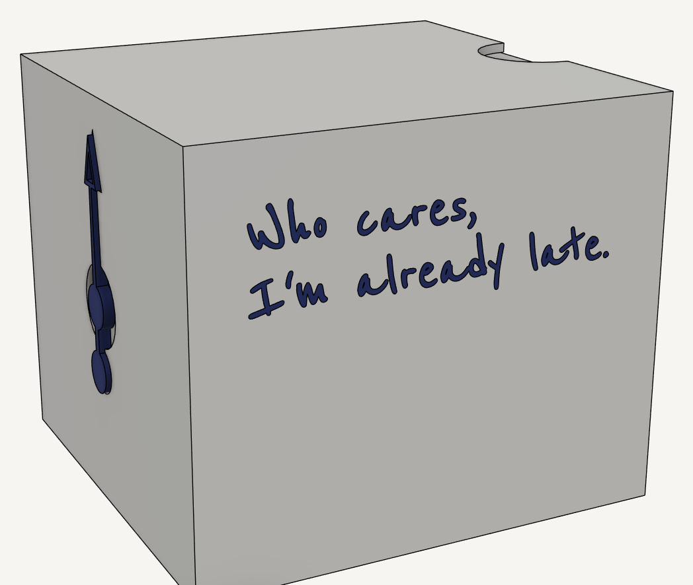
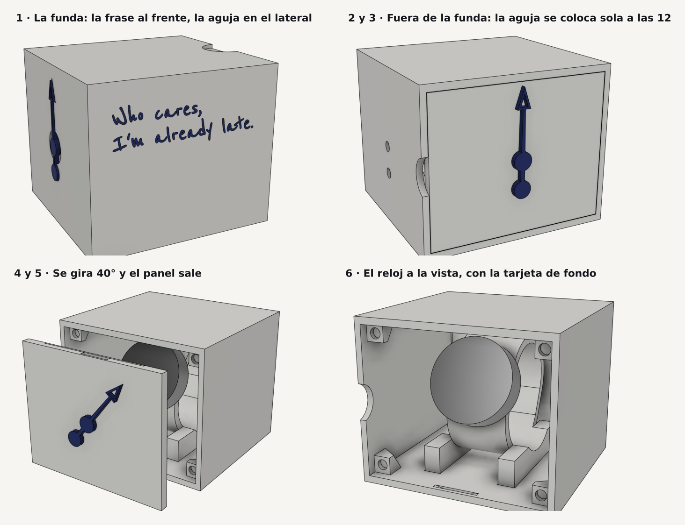

# Eventually — la caja

Caja impresa en 3D para el reloj **Eventually — Late Edition · 1 of 1**, un regalo montado a mano. Blanco papel y una sola pieza azul, como el reloj y [su web](https://pepe-a-d.github.io/eventually/).

**Estado a 19 de noviembre de 2026:** prototipo v2 («caja-expositor») modelado en Fusion. Nada impreso todavía.

## Cómo funciona

1. La funda lleva la frase en el frente y una aguja azul guardada en el lateral.
2. La caja sale deslizándose. Su frente es un panel liso, como una esfera en blanco.
3. La aguja se pone en el centro, a las 12, y se gira unos 40°. Un pestillo oculto la sigue por imanes y suelta el panel.
4. Sin el panel, la caja es un expositor: el reloj de pie, recostado 25°, con la tarjeta de fondo.

El detalle completo, con cortes, esquemas del mecanismo y mapa de imanes, está en **[reporte-v2/reporte-v2.pdf](reporte-v2/reporte-v2.pdf)** (también en [Markdown](reporte-v2/reporte-v2.md)).

## Qué hay en el repositorio

| Ruta | Qué es |
| --- | --- |
| `reporte-v2/` | Reporte ilustrado de la v2: PDF, HTML, Markdown y las 13 figuras |
| `Eventually-caja-v2.f3d`, `Eventually-caja-v2.step` | Modelo actual, para Fusion y para cualquier CAD |
| `imprimir-v2/` | Una pieza por fichero `.3mf`, para Bambu Studio |
| `generador_caja_v2.py`, `frase.json` | Script que construye el modelo en Fusion y los contornos de la frase |
| `parametros-fusion-v2.csv` | Los 75 parámetros del modelo v2 |
| `contexto.md` | Estado completo del proyecto: decisiones, medidas, riesgos y pendientes |
| `instrucciones-de-trabajo.md` | Cómo se trabaja en este proyecto con Claude |
| `capturas/` | Capturas del modelo, v1 y v2 |
| `BRIEF.md`, `parametros-fusion.csv`, `referencias/` | El brief original (v0) y sus referencias. Se conservan como punto de partida |
| `Eventually-caja-v1.*`, `imprimir-v1/`, `generador_caja_v1.py` | Versión anterior (se abría por arriba). Archivada |

## Medidas principales (v2)

| Pieza | Ancho × fondo × alto (mm) |
| --- | --- |
| Funda | 98,1 × 92,2 × 83,4 |
| Caja | 94,0 × 87,6 × 78,8 |
| Panel frontal | 87,6 × 4,6 × 71,6 |
| Aguja-llave | 51,8 de largo × 9,0 × 2,4 |

Usa 24 imanes de disco de 5 × 1,6 mm. Está pensada para una Bambu Lab X1 Carbon con AMS.

## Antes de imprimir

- Las medidas del reloj (corona, brazalete, cierre) son **supuestos**: hay que medir el reloj montado.
- Imprimir primero solo `tapa`, `rotor`, `tapeta` y `aguja` para comprobar que la llave magnética funciona.
- Las medidas no se cambian a mano en Fusion: se editan en `generador_caja_v2.py` y se regenera el modelo.
