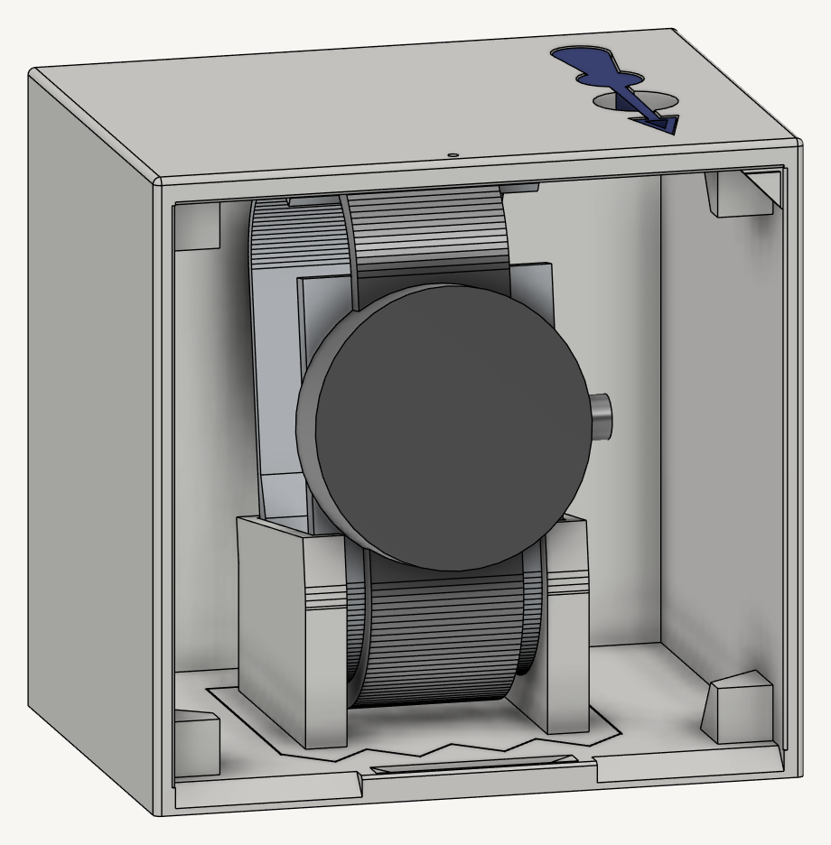

# Eventually — la caja

Caja impresa en 3D para el reloj **Eventually — Late Edition · 1 of 1**, un regalo montado a mano. Blanco papel y una sola pieza azul, como el reloj y [su web](https://pepe-a-d.github.io/eventually/).

> **Estado a 20 de noviembre de 2026: cambio de diseño.** Se imprimieron las probetas P0 y P1 de la v4.1 y la llave magnética no funcionó ([resultados](resultados-probetas.md)). La caja se rediseña: cilíndrica, con una tapa de iris y un ascensor que sube el reloj, movidos por un bisel con engranajes planetarios. **Lo actual es [BRIEF-v5.md](BRIEF-v5.md).** Nada de la v5 está modelado ni impreso. El resto de esta página describe la v4 y la v3, que quedan como historia.

**Estado anterior (v4, parada):** prototipo **v4** modelado en Fusion. La v4 responde al [contra-reporte de la v3](contra-reporte-v3.md); la respuesta punto por punto está en **[reporte-v4/reporte-v4.md](reporte-v4/reporte-v4.md)** (también en [PDF](reporte-v4/reporte-v4.pdf)). Sobre la v4 hay un **parche v4.1** que corrige lo que señala el [contra-reporte de la v4](contra-reporte-v4.md): [reporte-v4/parche-v4.1.md](reporte-v4/parche-v4.1.md). Las capturas y el resto de esta página son todavía de la v3: en la v4 la caja se cierra con la aguja puesta, el frente no tiene esquina cortada y el reloj sale deslizando con su peana.

## Cómo funciona

1. La funda es una campana: se levanta. Lleva la frase arriba y el NFC debajo, por dentro.
2. Queda un bloque blanco con una aguja azul tumbada encima, a ras.
3. La aguja se pone en el centro del frente y se gira 50° a la derecha. Un pestillo oculto la sigue por imanes y suelta el panel.
4. En la mano queda el panel, con la tarjeta por detrás. Dentro, el reloj de pie en su pinza.
5. Para cerrar se empuja el panel. Sin aguja.

## Qué hay en el repositorio

| Ruta | Qué es |
| --- | --- |
| `reporte-v4/` | Reporte de la v4, guía de montaje y plan de pruebas. **Lo actual** |
| `Eventually-caja-v4.*`, `imprimir-v4/`, `probetas-v4/`, `generador_caja_v4.py`, `parametros-fusion-v4.csv` | Modelo, piezas, probetas, generador y parámetros de la v4 |
| `contra-reporte-v3.md` | Revisión crítica de la v3. De ahí sale la v4 |
| `reporte-v3/` | Reporte de la v3, guía de montaje, plan de pruebas, cálculos y figuras |
| `contra-reporte-v2.md` | Revisión crítica de la v2. De ahí sale la v3 |
| `Eventually-caja-v3.f3d`, `Eventually-caja-v3.step` | Modelo actual |
| `imprimir-v3/` | 9 piezas en `.3mf`, ya orientadas para la cama |
| `probetas-v3/` | Las cinco probetas del plan de pruebas |
| `generador_caja_v3.py`, `frase-v3.json` | Script que construye el modelo en Fusion y los contornos de la frase |
| `parametros-fusion-v3.csv` | Los 135 parámetros del modelo |
| `contexto.md` | Estado completo del proyecto: decisiones, medidas, riesgos y pendientes |
| `instrucciones-de-trabajo.md` | Cómo se trabaja en este proyecto con Claude |
| `capturas/` | Capturas del modelo, v1, v2 y v3 |
| Todo lo que acaba en `v2` o `v1`, `reporte-v2/`, `BRIEF.md`, `parametros-fusion.csv`, `frase.json` | Versiones anteriores. Se conservan; ya no mandan |
| `referencias/` | Fotos de la esfera y del reloj, la tarjeta y el QR |

## Medidas principales (v3)

| Pieza | Ancho × fondo × alto (mm) |
| --- | --- |
| Funda | 98,6 × 74,9 × 94,4 |
| Caja | 94,0 × 70,3 × 91,7 |
| Panel frontal | 87,6 × 6,0 × 83,3 |
| Aguja-llave | 54,0 de largo × 9,0 × 2,6 |

Usa 8 imanes de disco de 5 × 1,6 mm (10 con una aguja de repuesto). Pensada para una Bambu Lab X1 Carbon con AMS. La pinza del reloj va en PETG; el resto, en PLA.

El alto depende del contorno del brazalete, que todavía es un supuesto (180 mm).

## Antes de imprimir la caja

- Imprimir las probetas, empezando por P0 y P1: [reporte-v3/plan-de-pruebas.md](reporte-v3/plan-de-pruebas.md).
- Medir el reloj montado. Las medidas de corona, brazalete y cierre son **supuestos**.
- Montaje, imanes y pausas de impresión: [reporte-v3/guia-de-montaje.md](reporte-v3/guia-de-montaje.md).
- Las medidas no se cambian a mano en Fusion: se editan en `generador_caja_v3.py` y se regenera el modelo.
