## Resumen

La v2 es una caja-expositor: se abre por delante con la aguja como llave y, abierta, presenta el reloj de pie con la tarjeta de fondo. Está modelada en Fusion y exportada; **no hay nada impreso ni medido sobre el reloj real**.

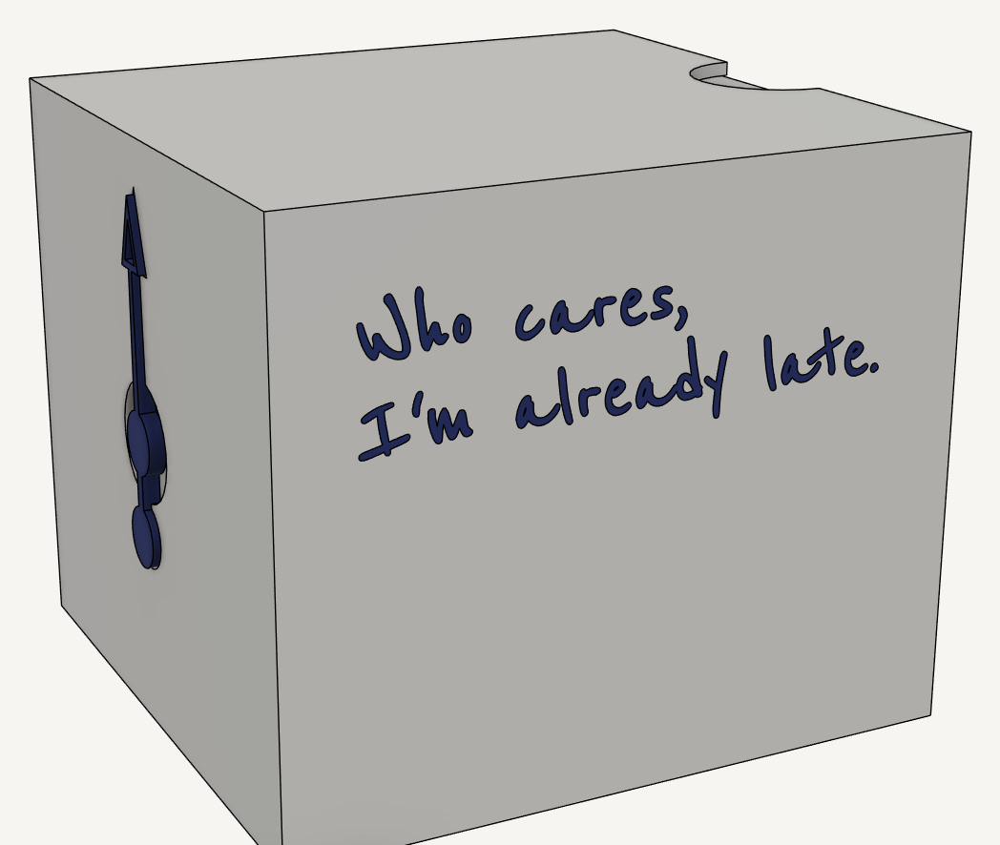

Sustituye a la v1, que se abría por arriba y obligaba a meter la mano 73 mm para sacar el reloj.

|  | v1 | v2 |
| --- | --- | --- |
| Apertura | Por arriba, tapa de 88 × 58 mm | Por delante, panel de 88 × 72 mm |
| Reloj | Tumbado en el fondo, esfera hacia arriba | De pie, recostado 25°, esfera al frente |
| Como expositor | Solo el soporte, fuera de la caja | La propia caja, con la tarjeta de telón |
| Tarjeta | En el suelo, bajo el soporte | De pie contra la pared del fondo |
| Aguja | 44 mm, 3,2 mm de grosor, flecha maciza | 51,8 mm, 2,4 mm de grosor, flecha calada |
| Frase | Sin frase | En el frente de la funda, en Reenie Beanie |
| Tamaño con funda | 98,5 × 68,6 × 86,1 mm | 98,1 × 92,2 × 83,4 mm |
| Imanes | 18 | 24 |

Todo está en `C:\Users\pepea\Documents\FusionClaude\WatchBox`. El modelo es `Eventually-caja-v2.f3d` y las piezas para imprimir están en `imprimir-v2\`.

**GitHub.** El repositorio es <https://github.com/Pepe-a-d/eventually-caja>. A 19 de noviembre de 2026 solo contiene el brief original (v0). La v2 está preparada en la carpeta de trabajo, con su `README.md`, pero aún no está subida: la sesión de Claude no tiene permiso de escritura en ese repositorio.

## Cómo se usa

Se abre en el mismo orden en que el reloj se monta en la web: primero el papel, luego la aguja, luego el reloj.

1. **La funda.** Blanca, con la frase en azul en el frente y la aguja guardada en el lateral cerrado.
2. **Sacar la caja.** Se pellizca por las muescas de arriba y de abajo y se desliza hacia fuera. Queda un bloque blanco con el frente liso.
3. **Poner la aguja.** Se coge la aguja de la funda y se acerca al centro del frente. Los imanes la colocan sola, con la punta hacia arriba, a las 12.
4. **Girar.** Se gira en sentido horario unos 40°, hasta la 1 y pico. El pestillo oculto la sigue y suelta el panel.
5. **Abrir.** Con la uña en la muesca de la pared izquierda se saca el panel. Se puede dejar pegado por imanes en la trasera.
6. **El reloj.** Queda a la vista, recostado sobre su soporte, con la tarjeta detrás. El soporte sale tirando hacia delante y sirve igual en la mesilla.

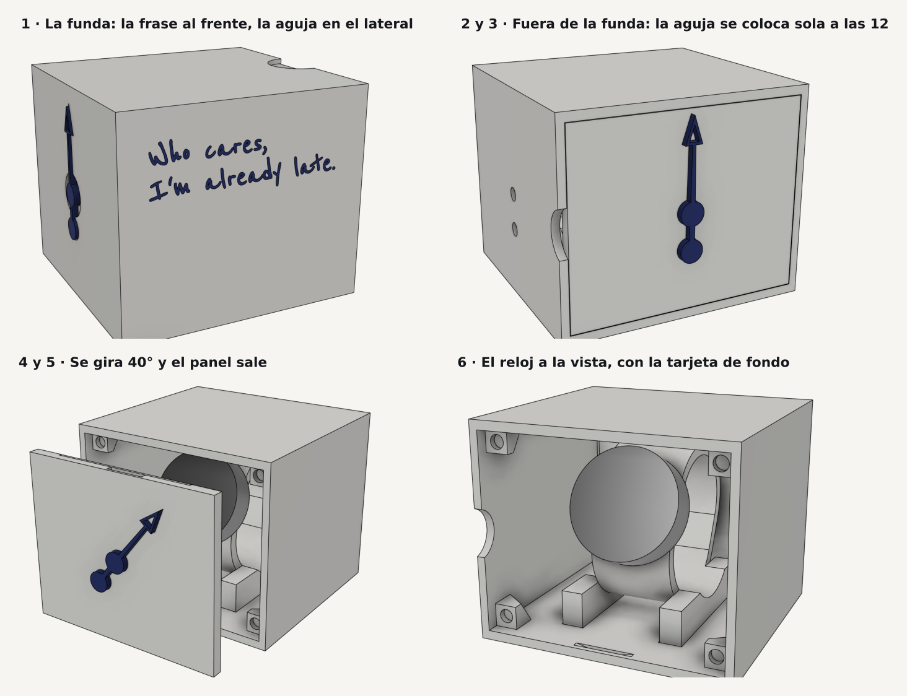

Para cerrar se hace al revés: panel dentro con la aguja girada, aguja de vuelta a las 12, aguja a la funda.

## Vistas generales

Por fuera es un bloque blanco de 98 × 92 × 83 mm con una sola cosa azul a la vista en cada cara: la frase en el frente y la aguja en el lateral.

Abierta, la caja mide 94 × 87,6 × 78,8 mm y deja un hueco de 88 × 80 × 72 mm. El reloj ocupa el centro, a 9,6 mm de la boca, con 21 mm libres a cada lado.

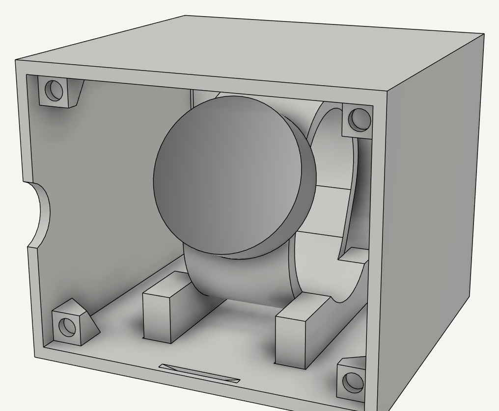

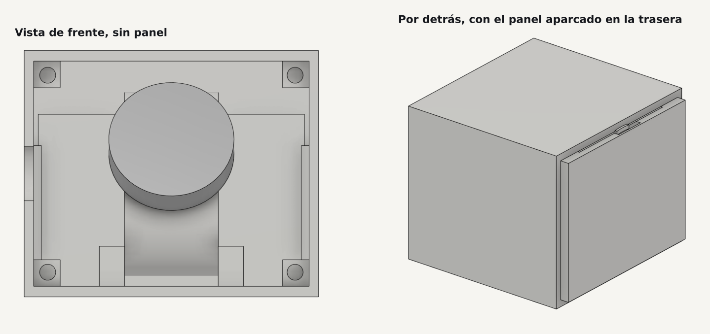

Las imágenes son capturas del modelo de Fusion. El reloj aparece como un disco gris de referencia, sin corona ni brazalete.

## Las piezas

Son ocho piezas impresas. La frase cuenta como pieza porque se imprime en otro color dentro de la funda.

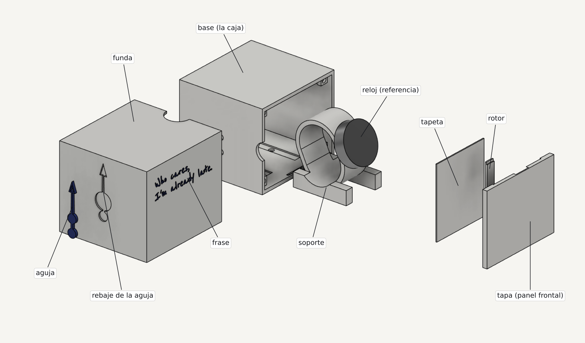

| Pieza | Qué hace | Ancho × fondo × alto (mm) | Volumen | Color |
| --- | --- | --- | --- | --- |
| `funda` | Envuelve la caja. Lleva la frase, la aguja guardada y el NFC | 98,1 × 92,2 × 83,4 | 92,1 cm³ | Mármol blanco |
| `frase` | Las letras, incrustadas 0,6 mm en la funda | 74,4 × 0,6 × 22,4 | 0,1 cm³ | Azul |
| `base` | La caja: cinco paredes, abierta por delante | 94,0 × 87,6 × 78,8 | 114,1 cm³ | Blanco |
| `tapa` | El panel frontal liso. Aloja el mecanismo | 87,6 × 4,6 × 71,6 | 19,7 cm³ | Blanco |
| `rotor` | La barra que gira dentro del panel y hace de pestillo | 14,0 × 2,2 × 74,6 | 1,4 cm³ | Blanco |
| `tapeta` | Cierra el mecanismo por detrás | 62,0 × 1,0 × 71,6 | 4,4 cm³ | Blanco |
| `aguja` | La llave | 51,8 de largo × 9,0 × 2,4 | 0,4 cm³ | Azul |
| `soporte` | Sujeta el reloj recostado, dentro y fuera de la caja | 46,0 × 60,0 × 63,2 | 30,0 cm³ | Blanco |

En total, 262 cm³ de plástico si todo fuera macizo. El peso real será menor y depende del relleno que se elija al laminar.

## El mecanismo de la llave

El panel no tiene agujeros ni ejes: la aguja mueve desde fuera, a través de 1 mm de plástico, una barra oculta que hace de pestillo.

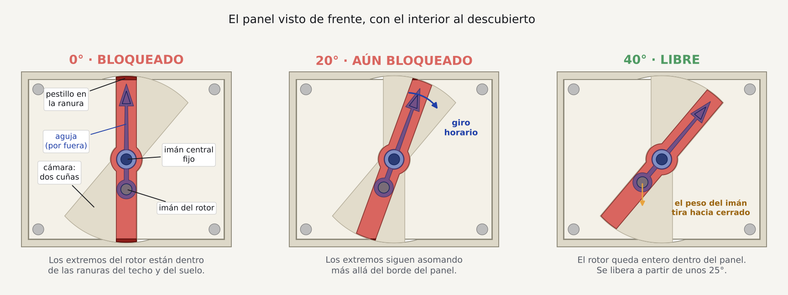

**Qué hay dentro del panel.** Tres capas en 4,6 mm de grosor: la piel exterior (1,0 mm), una cámara donde gira el rotor (2,5 mm) y la tapeta que la cierra por detrás (1,0 mm).

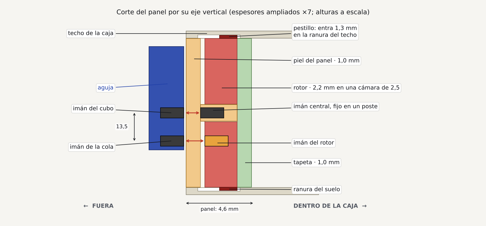

**Cuatro imanes hacen el trabajo.**

- Dos en la aguja: uno en el cubo y otro en el disco de la cola, a 13,5 mm.
- Uno fijo en el centro del panel. Atrae al del cubo y centra la aguja.
- Uno en el rotor, a 13,5 mm del centro. Lo atrae el de la cola: donde va la cola, va el rotor.

**Cómo bloquea.** El rotor es una barra vertical de 74,6 mm, 2,6 mm más larga que el hueco del panel. Sus dos extremos entran 1,3 mm en ranuras del techo y del suelo de la caja. Mientras esté vertical, el panel no puede salir.

**Cómo abre.** Al girar la aguja, el rotor gira con ella. A partir de unos 25° sus extremos quedan dentro del contorno del panel y este sale. La cámara tiene forma de dos cuñas que hacen de topes a 0° y a 40°.

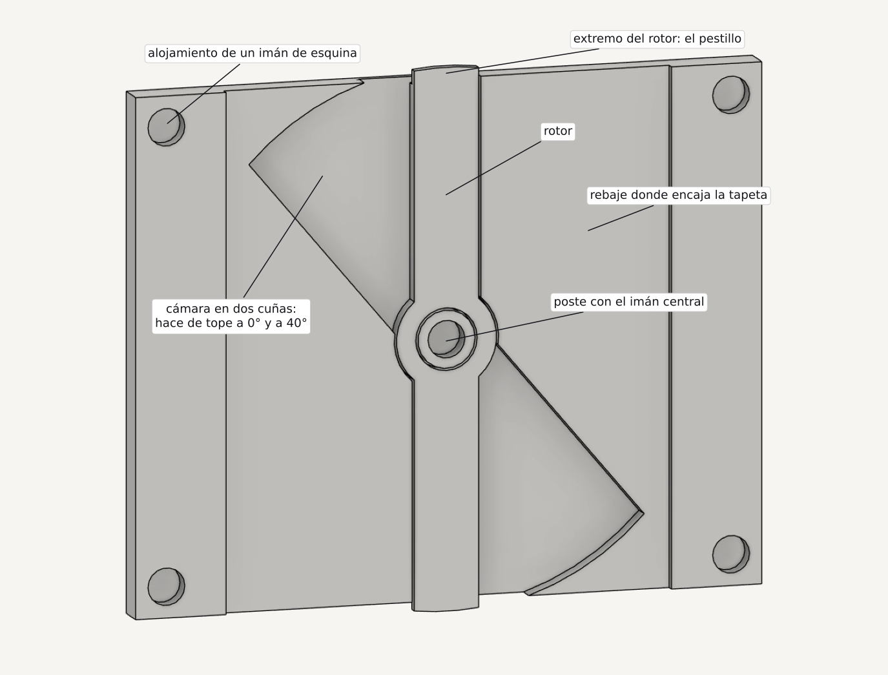

**Cierre por gravedad.** El único imán del rotor va en el brazo de abajo. Con la caja de pie pesa como un péndulo y tiende a devolver el rotor a la vertical, es decir, a cerrado. Es una idea sin probar.

| Giro de la aguja | Estado del panel |
| --- | --- |
| 0° a 20° | Bloqueado |
| 25° a 40° | Libre |
| Menos de 0° o más de 40° | No gira: tope de la cámara |

## La aguja-llave

Tiene la silueta del segundero del reloj: punta de flecha calada, varilla fina, cubo y un disco en la cola.

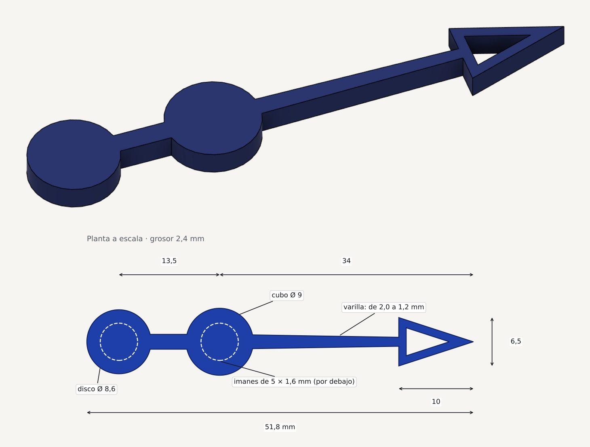

| Medida | Valor |
| --- | --- |
| Largo total | 51,8 mm |
| Del centro a la punta | 34 mm |
| Del centro al disco de la cola | 13,5 mm |
| Grosor | 2,4 mm |
| Varilla | De 2,0 mm junto al cubo a 1,2 mm junto a la flecha |
| Punta de flecha | 10 × 6,5 mm, contorno de 1,0 mm |
| Cubo | Ø 9 mm |
| Disco de la cola | Ø 8,6 mm |

Los dos imanes entran por debajo, uno en el cubo y otro en el disco de la cola, y quedan tapados por 0,6 mm de plástico por arriba. Por eso la varilla puede ser tan fina: no tiene que alojar nada.

Se guarda en el lateral cerrado de la funda, en un rebaje de 1,4 mm con su silueta. Sobresale 1,0 mm y tiene un plato de 17 mm alrededor del cubo para cogerla con dos dedos. Dos imanes de la funda la sujetan.

Con 1,2 mm en su punto más fino, es la pieza más frágil del conjunto. Conviene imprimir dos o tres.

## El expositor por dentro

El reloj va de pie y recostado 25° hacia atrás, a 5 mm del panel por delante, a 5 mm del techo y con el brazalete a 5,4 mm de la pared trasera.

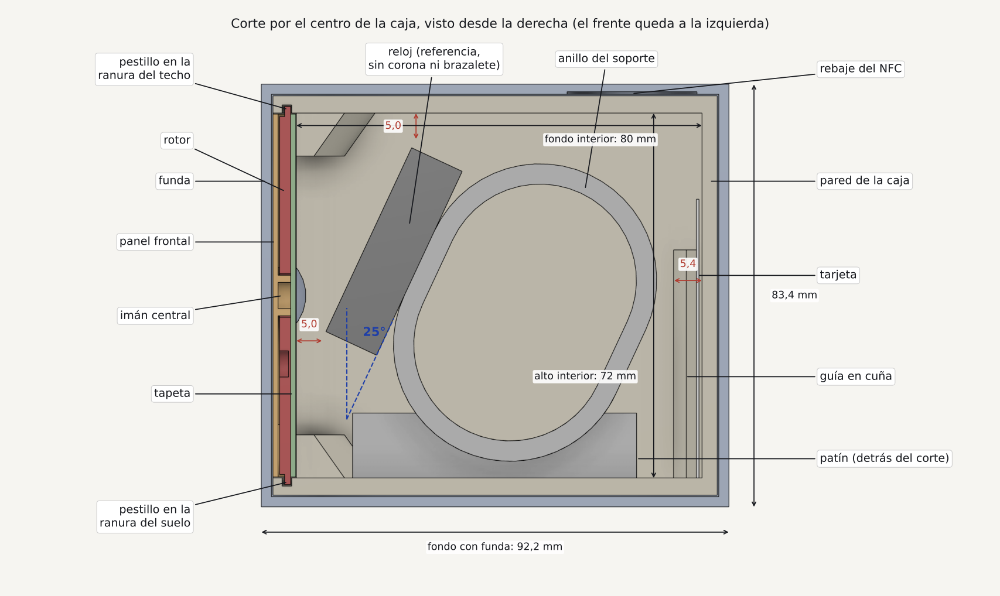

**El soporte.** Es un anillo ovalado de 60 × 46 mm y 30 mm de ancho, con 4 mm de pared, inclinado esos 25°. El brazalete se abrocha alrededor y el hueco interior deja meter los dedos para apretar el cierre. A cada lado lleva un patín de 8 × 14 × 56 mm que lo mantiene en pie y deja 4,5 mm libres debajo para el brazalete.

**Por qué no vuelca.** Los patines llegan 34 mm por delante del centro del anillo, hasta debajo de la caja del reloj, que es donde está el peso.

**Cómo se sujeta.** Los patines encajan en dos rebajes de 1,2 mm del suelo. Un imán en cada patín y otro debajo, en el suelo, lo fijan. Los del soporte van retirados 1,2 mm para que salga sin arrastrar la caja.

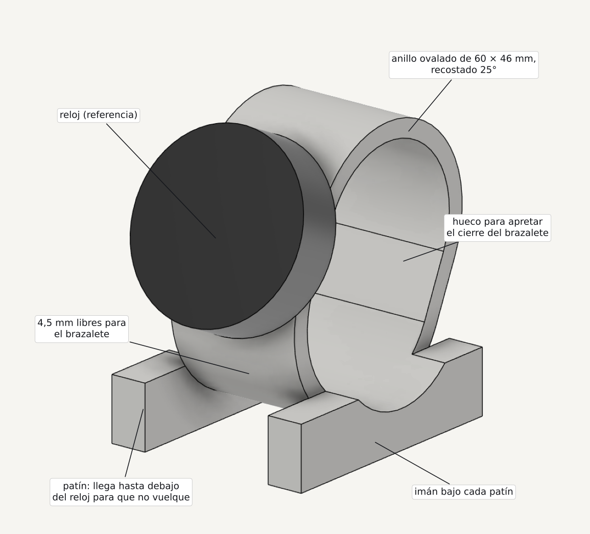

**La tarjeta.** Va de pie contra la pared del fondo, sujeta por dos guías en cuña de 2,5 mm en las paredes laterales. Se mete curvándola un poco. Con sus 85 × 55 mm llena casi todo el fondo, que mide 88 × 72.

**El acceso.** El soporte mide 46 mm de ancho en un hueco de 88: quedan 21 mm a cada lado para cogerlo.

## La funda y la frase

La frase va en el frente de la funda, arriba a la izquierda, en dos líneas: «Who cares,» / «I'm already late.»

**Tipografía.** Es Reenie Beanie, la manuscrita de la web. Los contornos salen del propio fichero de fuente del repositorio de la web (`fonts/reenie-beanie.woff2`), no de una fuente parecida.

**Tamaño.** El bloque mide 74,4 × 22,4 mm y está a 11 mm de la esquina. Va incrustado 0,6 mm en una pared de 2 mm.

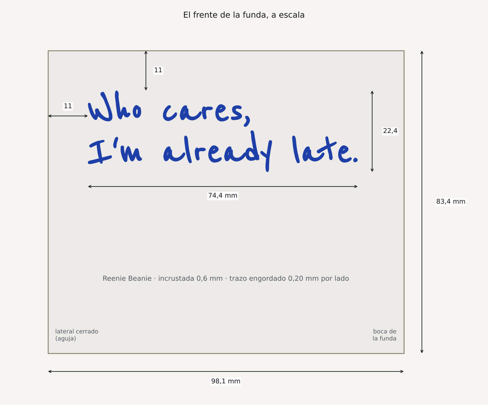

**Trazo engordado.** A ese tamaño el trazo original mide 0,56 mm de media, demasiado fino para una boquilla de 0,4. Lo he engordado 0,20 mm por cada lado: queda en 0,95 mm de media y el 98,7 % del área aguanta un trazo de 0,8 mm. La letra se ve algo más gruesa que en la web, como escrita con rotulador.

**Puntuación.** Lleva coma y punto, como en la web. En las fotos de la esfera no los lleva; esas fotos son de IA, así que está pendiente de mirar la esfera real.

**El resto de la funda.**

- Pared de 2 mm y 0,3 mm de holgura por lado con la caja.
- Abre por el lateral derecho. Muescas de 12 mm de radio arriba y abajo para sacar la caja.
- Lateral cerrado de 3,8 mm: rebaje de la aguja por fuera y dos imanes por dentro, que sujetan la aguja y hacen el clic con la caja.
- Rebaje para la etiqueta NFC (Ø 25,6 × 0,5 mm) en el techo, por dentro, desplazado 27 mm hacia el fondo.

## Los imanes

La caja usa 24 imanes de disco de 5 × 1,6 mm, repartidos en cinco funciones.

| Función | Cuántos | Dónde van |
| --- | --- | --- |
| Llave | 4 | Cubo y cola de la aguja; centro del panel; brazo inferior del rotor |
| Clic del panel | 8 | Cuatro en las esquinas del panel, por detrás; cuatro en los refuerzos de las esquinas de la caja |
| Soporte | 4 | Uno bajo cada patín; dos en el suelo de la caja |
| Panel aparcado | 4 | En las esquinas de la cara trasera de la caja, por fuera |
| Funda | 4 | Dos en el lateral cerrado de la funda, por dentro; dos en la pared izquierda de la caja, por fuera |

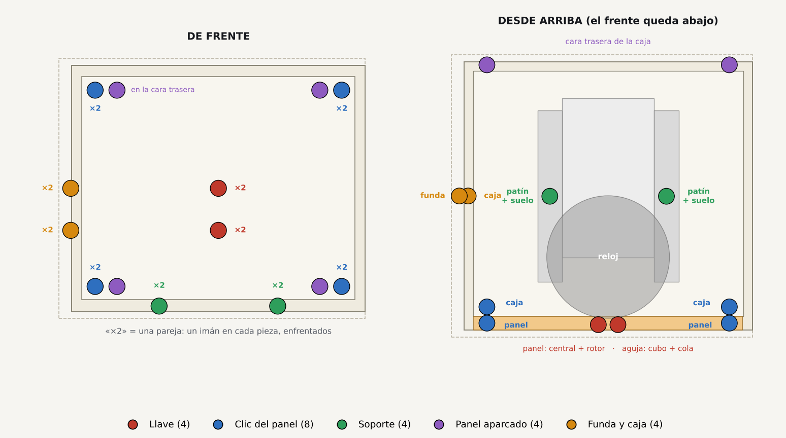

Por pieza: `base` 12, `tapa` 5, `funda` 2, `aguja` 2, `soporte` 2 y `rotor` 1. Cada aguja de repuesto lleva 2 más.

**Alojamientos.** Todos miden Ø 5,15 × 1,8 mm: el imán entra a presión y se fija con una gota de cianoacrilato. Los de las esquinas van 0,5 mm más hondos para suavizar el clic, y los de los patines 1,2 mm más hondos para que el soporte salga sin arrastrar la caja.

**Reglas de montaje.**

1. Cada pareja enfrentada tiene que atraerse. Antes de pegar un imán, preséntalo contra su pareja.
2. Marca con rotulador una cara de todos los imanes usando una pila como referencia. Así sabes siempre cuál es cuál.
3. Los cuatro de la cara trasera muestran hacia fuera la misma cara que los de los refuerzos muestran hacia el frente. Si no, el panel no se queda aparcado.
4. Propuesta: montar los dos imanes de arriba del panel al revés que los dos de abajo, y lo mismo en la caja. Así el panel se repele si se intenta poner boca abajo, que es la única forma de montarlo mal.

**Cerca del reloj.** Los imanes del panel quedan a 23,7 mm (central) y 31,3 mm (rotor) del centro del movimiento, y a 11,2 mm del punto más cercano del reloj, el borde inferior del bisel. Es mejor que en la v1, donde el imán central quedaba encima del cristal. Sigue pendiente comprobarlo con el reloj real.

## Medidas y comprobaciones

El modelo pasa las comprobaciones geométricas hechas en Fusion; ninguna sustituye a imprimir y probar.

| Comprobación | Resultado |
| --- | --- |
| Interferencias entre los 10 cuerpos (análisis de Fusion) | Ninguna |
| Rotor contra panel y caja, de 0° a 40° | No se tocan |
| Panel bloqueado con el rotor de 0° a 20° | Sí |
| Panel libre con el rotor de 25° a 40° | Sí |
| Topes de la cámara por debajo de 0° y por encima de 40° | Paran el rotor |
| Pieza mayor (funda, 98,1 × 92,2 × 83,4 mm) en la X1 Carbon | Cabe |
| QR de la tarjeta | Lleva a la web |

**Holguras y paredes.**

| Medida | Valor |
| --- | --- |
| Holgura entre funda y caja, por lado | 0,3 mm |
| Holgura entre panel y caja, por lado | 0,2 mm |
| Juego del rotor en su cámara | 0,3 mm |
| Paredes laterales y fondo de la caja | 3,0 mm |
| Techo y suelo de la caja | 3,4 mm |
| Pared de la funda | 2,0 mm |
| Piel del panel sobre el mecanismo | 1,0 mm |
| Lo que entra cada pestillo en techo y suelo | 1,3 mm |
| Pared que queda por fuera de la ranura del pestillo | 1,8 mm |

**Medidas del reloj.** Diámetro (40 mm), grosor (11 mm) y de asa a asa (44 mm) vienen de la ficha del vendedor. El ancho con corona (43,5 mm), el brazalete (27 mm de ancho, 3,5 mm de grosor), el óvalo del soporte (60 × 46 mm) y el tipo de cierre son **supuestos**: hay que medirlos con el reloj montado.

Los 75 parámetros están en `C:\Users\pepea\Documents\FusionClaude\WatchBox\parametros-fusion-v2.csv`.

## Impresión

Las ocho piezas están en `C:\Users\pepea\Documents\FusionClaude\WatchBox\imprimir-v2\`, una por fichero `.3mf`, listas para abrir en Bambu Studio. Las orientaciones son propuestas: no se ha laminado ninguna pieza.

| Pieza | Cómo colocarla en la cama | Soportes | Filamento |
| --- | --- | --- | --- |
| `base` | Pared trasera abajo, boca hacia arriba | No debería necesitar: refuerzos y guías están a 45° | Blanco mate |
| `tapa` | Cara lisa abajo | No | Blanco mate |
| `tapeta` | Plana | No | Blanco mate |
| `rotor` | Plano, con el alojamiento del imán hacia arriba | No | Blanco mate |
| `aguja` | Plana, con los alojamientos de los imanes hacia abajo | No | Azul mate, cercano a `#1F3FA8` |
| `soporte` | De pie, como va en la caja | Sí, bajo el anillo | Blanco mate |
| `funda` + `frase` | Juntas, como un solo objeto de dos piezas | Depende de la orientación | Mármol blanco + azul |

**La funda tiene dos opciones.** Con la cara de la frase sobre la cama la letra sale más nítida, pero la cara opuesta queda en puente y pide soportes por dentro. De pie sobre el lateral cerrado no hay puentes, pero la frase queda en una pared vertical y obliga a cambiar de color en unas 110 capas.

**En Bambu Studio.**

- Textura de papel: activar «fuzzy skin» solo en el contorno exterior de la funda. Las caras que deslizan, lisas.
- Altura de capa de 0,16 a 0,2 mm. La piel de 1,0 mm del panel son 5 capas de 0,2.
- Los imanes ocultos del rotor y de la aguja se pueden meter después de imprimir; no hace falta pausar.

**Orden recomendado.** Primero `tapa`, `rotor`, `tapeta` y `aguja`. Con esas cuatro piezas y cuatro imanes se comprueba en la mano si la llave funciona, antes de gastar plástico en la caja.

## Lo que falta

Lo que decide si este diseño vale es si el imán de la cola de la aguja arrastra el rotor, y eso solo se sabe imprimiendo.

**Sin comprobar.**

| Duda | Por qué importa | Cómo se resuelve |
| --- | --- | --- |
| ¿Arrastra la aguja un rotor de 74,6 mm? | Es todo el mecanismo. El brazo de arrastre es de 13,5 mm | Imprimir tapa, rotor, tapeta y aguja. Si no tira: piel de 0,8 mm o dos imanes apilados en la cola. Si aun así no, plan B del brief (rampa helicoidal) |
| ¿Funciona el cierre por gravedad? | Es lo que impide que el rotor se abra solo | Con la misma probeta, de pie y tumbada |
| ¿Aguanta la aguja? | Mide 1,2 mm en su punto más fino | Usarla; imprimir repuestos |
| ¿Se lee el NFC con el reloj dentro? | El acero y los imanes lo pueden bloquear | Probarlo con el móvil |
| ¿Afectan los imanes al reloj? | Es mecánico: si se magnetiza, adelanta | Brújula o app de magnetómetro donde irá el reloj |
| ¿Se queda la tarjeta en su sitio? | Las guías no la retienen por arriba | Probar con la caja boca abajo |
| ¿Son buenas las holguras? | 0,2 y 0,3 mm son valores de partida | Ajustar tras la primera impresión |

**Lo que este prototipo no lleva.**

- Redondeos y chaflanes: todas las aristas están vivas.
- Los tres nervios de apoyo del rotor y el clic en los topes que pedía el brief.
- Algo que impida montar el panel boca abajo; la propuesta es hacerlo con la polaridad de los imanes.
- La corona y el brazalete en el volumen de referencia del reloj.

**Próximos pasos.**

- Dar el visto bueno a la apertura frontal, la inclinación del reloj y la forma de la aguja.
- Decidir si la frase lleva coma y punto.
- Decir la fecha de entrega del regalo.
- Imprimir la probeta: tapa, rotor, tapeta y aguja.
- Medir el reloj montado: corona, brazalete abrochado y cierre.
- Con el brazalete real, ver si el óvalo se puede aplanar para acortar la caja.
- Añadir redondeos y los detalles que faltan.
