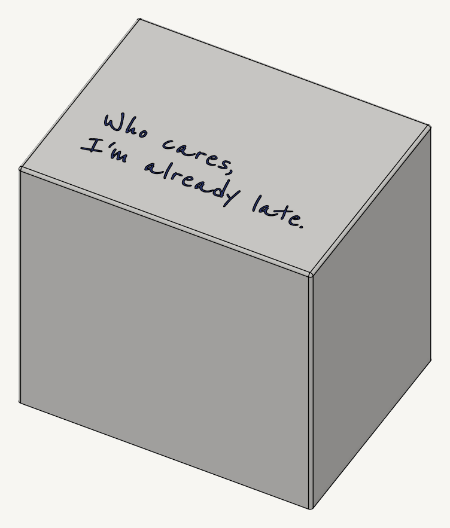
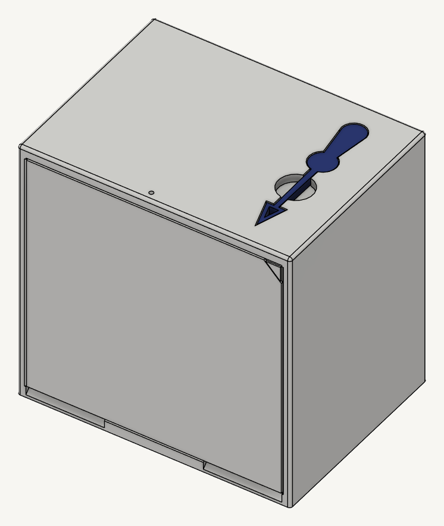
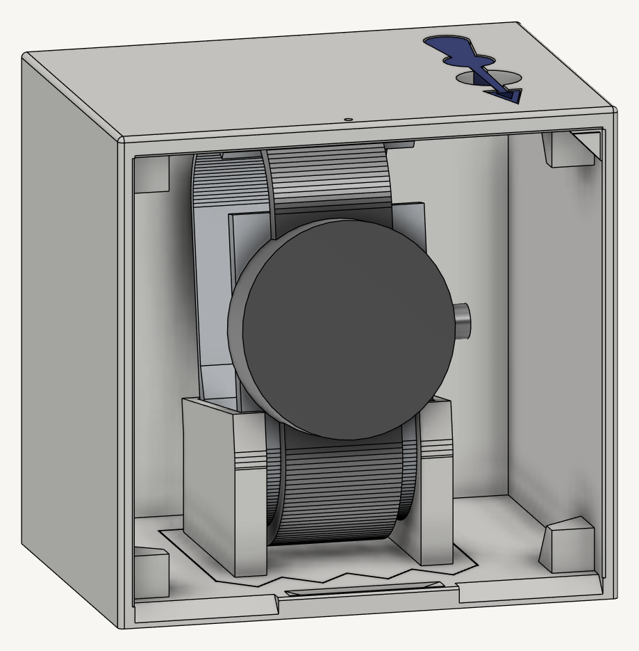
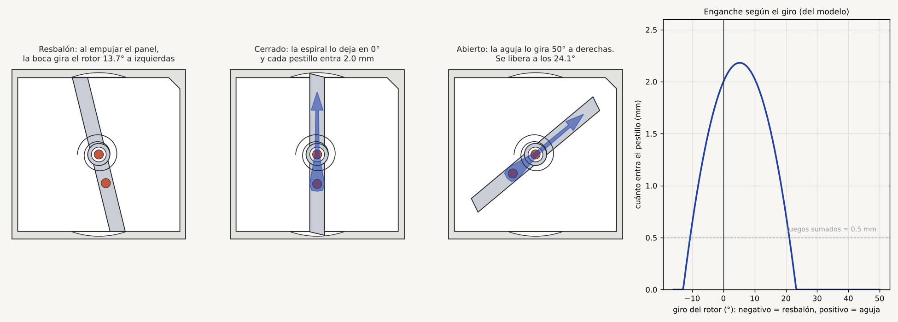
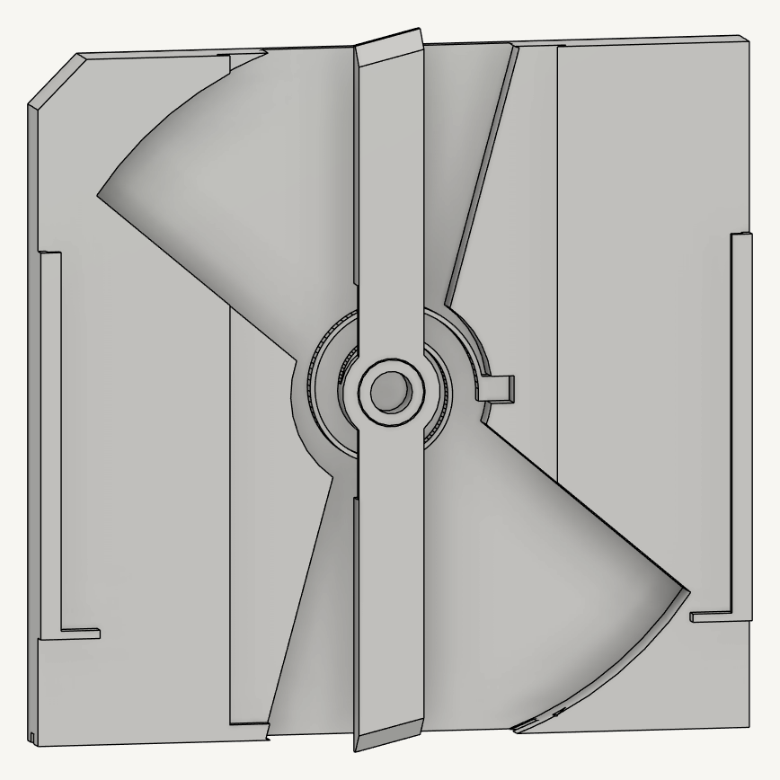
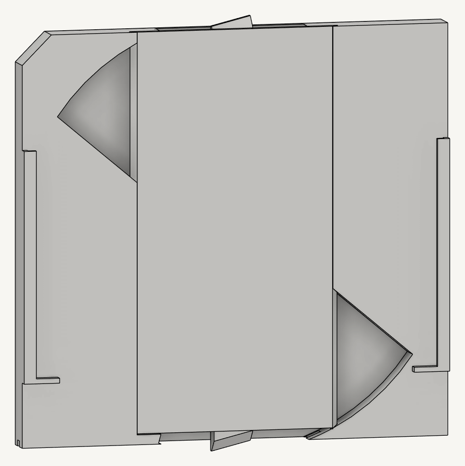
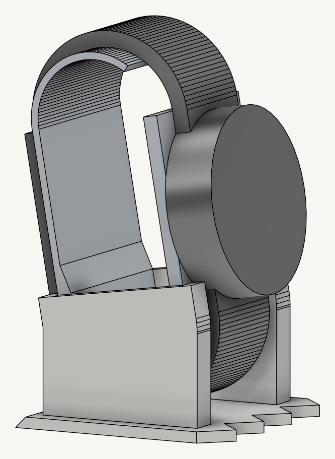
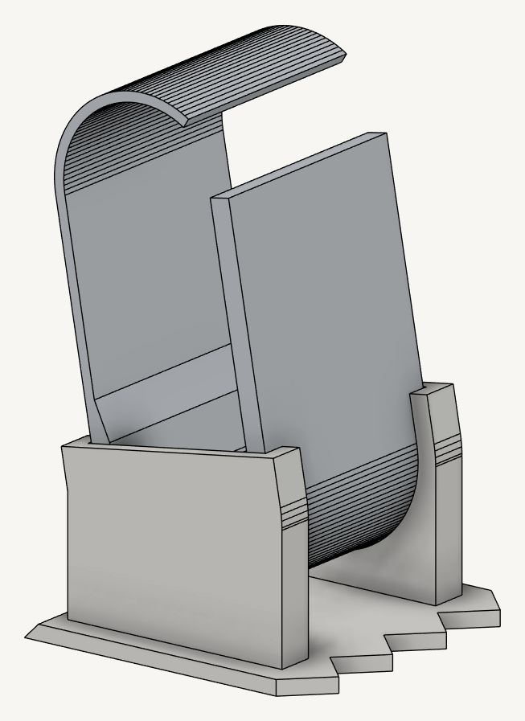
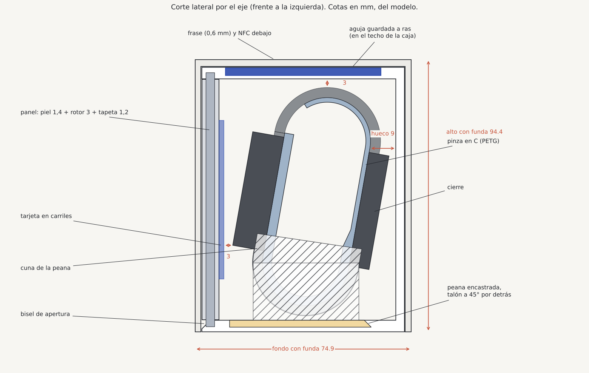
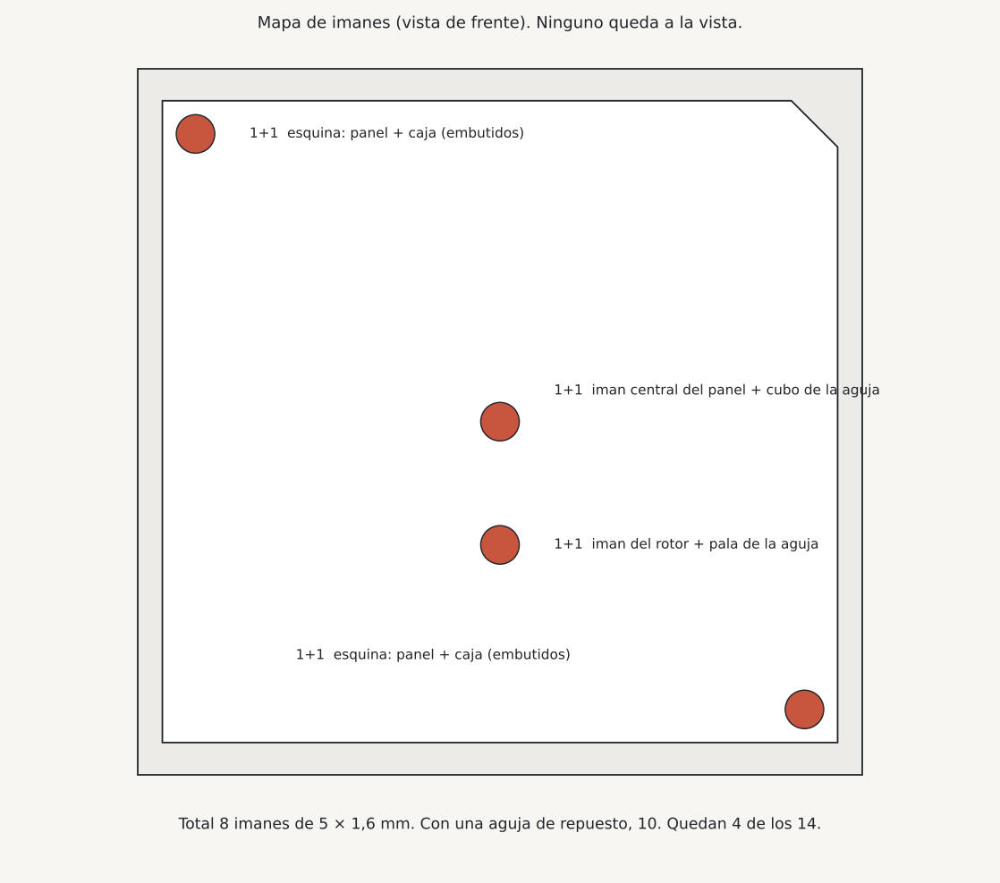

# Eventually, la caja: prototipo v3

Respuesta al contra-reporte de la v2 (`contra-reporte-v2.md`, commit `4153169`).

Escrito el 19 de noviembre de 2026. La v3 está **modelada en Fusion y exportada**. **No hay nada impreso ni probado.** Todo lo que este documento da por bueno lo es en el modelo o en el cálculo, y así se indica: **del modelo** (medido en Fusion), **calculado** (con `imanes.py` y `figuras_v3.py`, que están en esta carpeta) o **decisión** (lo he elegido yo y se puede cambiar).

## 1. Resumen

- **Hecho.** Un modelo nuevo completo, generado por `generador_caja_v3.py` (135 parámetros), con sus ficheros de impresión ya orientados (`imprimir-v3/`), las cinco probetas del plan de pruebas (`probetas-v3/`), una guía de montaje y este reporte.
- **Los 6 fallos graves** del contra-reporte tienen solución en el modelo. Dos de ellas no son exactamente las que proponía el contra-reporte, porque tal como estaban descritas no funcionan; se explica en el apartado 3.
- **8 imanes**, ninguno a la vista. Con una aguja de repuesto, 10. Tienes 14.
- **Tamaño con funda: 98,6 × 74,9 × 94,4 mm** (ancho × fondo × alto). El fondo baja 17 mm respecto a la v2 y cumple el objetivo de 75. **El alto sube 11 mm.** Lo fija el brazalete, y su medida sigue sin conocerse (apartado 5).
- **Lo que no he hecho:** mover `BRIEF.md` y la v1 a una carpeta `archivo/` (punto 20), el aviso del imán en la tarjeta o en la web (punto 22) y el texto interior (punto 23). Motivos en el apartado 4.
- **Lo siguiente no es modelar más.** Es imprimir la probeta P0 y la P1. Ver `plan-de-pruebas.md`.

 

## 2. Cómo se usa

1. **Levantas la funda.** Es una campana: sale hacia arriba. La frase está en la cara de arriba y el NFC debajo de la frase, por dentro.
2. **Queda un bloque blanco con una aguja azul tumbada encima**, a ras, en el lado derecho.
3. **Coges la aguja y la acercas al centro del frente.** Se pega sola, vertical, con la punta hacia arriba.
4. **La giras a la derecha**, como si adelantaras la hora, hasta que hace tope a los 50°. Se queda ahí.
5. **Tiras del panel por abajo.** Hay un bisel bajo el borde y una ranura para la uña.
6. **En la mano tienes el panel con la tarjeta** en su cara interior. Dentro, el reloj de pie.
7. **Para cerrar, empujas el panel.** No hace falta la aguja: los pestillos se apartan solos y vuelven.

## 3. Respuesta punto por punto

### Fallos graves

| | Qué pedía el contra-reporte | Qué hay en la v3 | Estado |
| --- | --- | --- | --- |
| **G1** | Soporte en dos piezas: pinza en C elástica y peana. PETG. Extrusión pura. Hueco de 8 mm para el cierre. | Pinza en C de 36 mm de ancho: cara plana rígida de 43 mm (3,2 de grueso) y brazo elástico de 1,6. Contorno sin reloj 199 mm (**del modelo**), pensada para brazaletes de 160 a 200. Peana con dos cunas donde la pinza **se deja caer desde arriba**; el brazalete pasa entre las cunas. Hueco tras la pinza: 9 mm. | Modelado. Sin probar: P3 |
| **G2** | Pestillo de resbalón con chaflán en los extremos del rotor. | Hecho, **con otra geometría** (ver 3.1). Comprobado en el modelo: al empujar el panel, la boca gira el rotor 13,7° y lo deja pasar. | Modelado. Sin probar: P2 |
| **G3** | Muelle impreso: un brazo fino que apoya en un tetón. | Hecho, **como espiral** (ver 3.2). Par a 50°: 1,0 mN·m (**calculado**). Relajado en cerrado. | Modelado. Sin probar: P2 |
| **G4** | Taladro de emergencia de 1,5 mm. Tapeta desmontable, sin pegamento. | Taladro en el techo, sobre el pico del pestillo: al empujar con un clip, el rotor gira como en el resbalón y suelta los dos pestillos. Tapeta en cola de milano: entra por arriba y hace tope abajo; con el panel puesto, el techo la retiene. | Modelado |
| **G5** | Tarjeta en carriles en U con tope recto, en el panel o delante del soporte. | En la cara interior del panel. Dos carriles en U y dos topes rectos. La tarjeta asoma 9 mm por arriba para cogerla. | Modelado. Sin probar: P1 |
| **G6** | Aguja guardada a ras en la cara de arriba de la caja interior. | Hecho. Va tumbada de atrás adelante, en el lado derecho (ver 3.3). La funda la tapa. Sin imán. | Modelado |

### Fallos importantes

| | Qué hay en la v3 | Estado |
| --- | --- | --- |
| **I1** Apertura | Tope a 50°. La aguja se queda girada: su rozamiento es 5 veces el par del muelle (**calculado**). Bisel bajo el panel, **en dos tramos** (ver 3.4), y ranura para la uña. Sujeción del panel: 2,3 N (**calculado**). Aguja plana, sin pomo. | Modelado |
| **I2** Tamaño | 98,6 × 74,9 × 94,4 mm. Fondo −17 mm; alto +11 mm; volumen −8 %. | Parcial: ver 5 |
| **I3** Funda | De campana. Frase en la cara que toca la cama, en 3 capas. Sin texto en las paredes. | Modelado. Sin probar: P4 |
| **I4** Imanes | 8. Los cuatro de esquina, embutidos con pausa bajo 0,8 mm. Los dos de la aguja, bajo 0,4 mm. El central y el del rotor, dentro del mecanismo. | Modelado |
| **I5** Piel | 1,4 mm. Imán central retirado 0,4 mm. El relleno opaco es un ajuste de impresión: está en la guía. | Modelado. Sin probar: P0 |
| **I6** Aguja | Imanes embutidos. Cola en pala. Varilla de 2,2 a 1,6 mm. Contorno de la flecha de 1,2. | Modelado |
| **I7** Panel aparcado | Quitado, con sus 4 imanes. | Hecho |
| **I8** Soportes | Ninguna pieza los necesita. La pinza se imprime de canto; la peana, de pie. | Modelado |
| **I9** NFC | Bajo la frase, por dentro del techo de la funda. | Modelado. Sin probar: P4 |
| **I10** Enganche | 2,0 mm. Juego del eje 0,15 mm. Giro 50°. Se libera a 24,1° (**del modelo**; el contra-reporte estimaba 26°). | Modelado |
| **I11** Panel al derecho | Esquina superior derecha achaflanada 6 mm, en el panel y en la boca. | Modelado |

### 3.1 El resbalón: por qué no es solo un chaflán

Un chaflán en la punta de un rotor centrado no lo hace girar: la boca empuja hacia el eje y el empuje no tiene brazo. Y aunque lo tuviera, el rotor necesitaría girar 26° en los 5 mm que entra el panel; la rampa saldría tan tendida que el rozamiento la bloquearía.

Lo que hay en la v3:

- **El pico del pestillo no está en el centro**, sino en la esquina izquierda de la barra, a 4 mm del eje. La boca lo empuja hacia abajo y eso sí hace girar el rotor.
- **El canto del pestillo está inclinado** lo justo para quedar a ras del panel cuando el rotor ha girado 13,7° a izquierdas.
- **El rotor gira hacia los dos lados**: 13,7° a izquierdas para cerrar de un empujón, 50° a derechas con la aguja para abrir.

Consecuencia: el rotor no descansa contra un tope, sino donde lo deja el muelle. El enganche aguanta ese margen: está por encima de 1 mm entre −8° y +18,5° (**del modelo**).

| Panel a… de su sitio | Giro que la boca le pide al rotor (**del modelo**) |
| --- | --- |
| 4,0 mm o más | 0° |
| 3,5 mm | 4,5° |
| 3,0 mm | 8° |
| 2,5 mm | 11° |
| 2,0 a 0,5 mm | 13° |
| 0 mm | 0°: el pestillo salta a su ranura |

### 3.2 El muelle: por qué es una espiral

Un brazo recto que tenga que doblarse 50° se deforma cerca de un 3 %: el plástico cede. Una espiral reparte el giro en 76 mm de longitud y trabaja al 0,35 % (**calculado**).

- 1,5 vueltas alrededor del cubo, 0,6 mm de grueso y 1,6 de alto. Es parte del rotor.
- Acaba en un taco que entra en una muesca del panel.
- Trabaja igual hacia los dos lados, que es lo que pide el resbalón.
- Par a 50° (**calculado**, con un módulo de 3 000 MPa): 0,42 mN·m con 0,45 mm de grueso, 1,0 con 0,6 y 2,4 con 0,8. La probeta P2 trae los tres.

Lo que la aguja le saca al rotor (**calculado**, a 2,0 mm de separación): 6,9 mN·m de arrastre, menos 1,9 de rozamiento. Quedan 5,0 para vencer 1,0 de muelle.

 

Las dos ventanas que deja la tapeta las tapa la tarjeta. Son a propósito: así el panel se imprime sin puentes.

### 3.3 La aguja guardada

Va de atrás adelante, con la punta hacia el frente. Dos motivos:

- **Impresión.** La caja se imprime con la pared trasera en la cama. Con la aguja a lo ancho, su rebaje sería un puente de 54 mm en una cara vista.
- **NFC.** El eje de la aguja queda a 17 mm del borde de la etiqueta.

Tiene un rebaje redondo de 12 mm a media varilla para pellizcarla. Rompe un poco el «a ras con su silueta»; si no te gusta, es el parámetro `aguja_una_d`.

### 3.4 El bisel de apertura no es a todo lo ancho

El pestillo de abajo engancha en los 34 mm centrales del suelo. Un bisel ahí se lo llevaría. Hay dos tramos de 27 mm, uno a cada lado.

### 3.5 El soporte

 

- **El reloj se abrocha en la pinza suelta**, fuera de la caja.
- **La pinza se deja caer en las cunas.** Entra por arriba, queda recostada 10° y no puede girar: la sujetan una uña delantera de 7 mm y una trasera de 8.
- **La peana encaja por forma, sin imanes:** un talón a 45° por detrás y cuatro dientes por delante. Se mete primero el talón y se baja el frente.
- **Límite conocido:** boca abajo, la peana puede levantar el frente unos 3 mm, hasta que el brazalete toca el techo. Vuelve a su sitio sola. Si molesta, dos de los imanes de reserva lo arreglan.

## 4. Especificación de la v3, punto por punto

| # | Punto | Estado |
| --- | --- | --- |
| 1 | Pinza en C y peana, hueco de 8 mm | Hecho (9 mm) |
| 2 | Pestillo de resbalón | Hecho, con otra geometría (3.1) |
| 3 | Muelle impreso | Hecho, en espiral (3.2) |
| 4 | Taladro de emergencia y tapeta desmontable | Hecho |
| 5 | Aguja guardada arriba, a ras | Hecho |
| 6 | Tarjeta en carriles en U | Hecho, en el panel |
| 7 | Imanes de la aguja embutidos, pala, varilla ≥ 1,6 | Hecho |
| 8 | Enganche 2 mm, juego 0,15, giro 50° | Hecho |
| 9 | Esquina achaflanada | Hecho |
| 10 | Reloj de referencia completo | Hecho: cabeza, corona, brazalete y cierre. **Sus medidas siguen siendo supuestas** |
| 11 | Funda de campana | Hecho |
| 12 | Frase sin engordar | Hecho: trazo medio de 0,56 mm; el 98 % se imprime con una línea de 0,42 |
| 13 | Bisel a todo lo ancho, fuera la muesca | Parcial: dos tramos (3.4). La muesca lateral ya no existe |
| 14 | Piel de 1,4 mm con relleno opaco | Hecho (el relleno es ajuste de impresión) |
| 15 | Sujeción en torno a 2 N | 2,3 N. Puede llegar a 3,1 si los imanes se mueven en su alojamiento |
| 16 | 14 imanes como máximo, ninguno a la vista | Hecho: 8 |
| 17 | Fuera el panel aparcado | Hecho |
| 18 | Redondeos de 1 mm fuera y 0,5 en la boca | Parcial: 1 mm fuera, hecho. La boca lleva un chaflán de 0,5, no un redondeo. La arista que apoya en la mesa queda viva |
| 19 | Todos los números a `P_DEF` | Casi: 135 parámetros. Quedan unas diez constantes de construcción (solapes de uniones y márgenes de cajas de corte). Una sola es funcional: 1,2 mm de plástico bajo los imanes de esquina |
| 20 | `BRIEF.md` y la v1 a `archivo/` | **No hecho.** Desde esta sesión no puedo escribir en GitHub ni mover ficheros en tu carpeta. Instrucciones en el apartado 8 |
| 21 | Aguja con pomo | No. Pediste una aguja fina. Decides tú |
| 22 | Aviso «la aguja es un imán» | **No hecho.** La tarjeta está en Figma y la web en otro repositorio. Texto propuesto: «La aguja lleva imanes. No la dejes sobre el reloj.» |
| 23 | Texto por dentro | No. Decides tú |

Del apartado 6 del contra-reporte (proceso):

- **Comprobaciones más finas.** El pestillo se prueba grado a grado. El resbalón, paso a paso. Las holguras se miden, no solo «no se solapa».
- **Fuerzas.** `imanes.py` reproduce la tabla 3.1 del contra-reporte con dos decimales. Los números de la v3 están en `calculos-v3.txt`.
- **Plan de pruebas, guía de montaje y probeta de tolerancias:** hechos.
- **«Tres versiones sin imprimir»:** ahora son cuatro. Pediste la v3 y está hecha, pero la crítica sigue en pie. Las probetas están listas para que la siguiente decisión salga de la impresora.

## 5. El tamaño depende del brazalete

La caja se calcula a partir de `brazalete_contorno`, que hoy vale 180 mm **por suposición**. Con el dato real cambia sola:

| Contorno interior del brazalete | Exterior con funda (**calculado**) |
| --- | --- |
| 160 mm | 98,6 × 73,1 × 84,6 |
| 170 mm | 98,6 × 74,0 × 89,5 |
| **180 mm (supuesto)** | **98,6 × 74,9 × 94,4** |
| 190 mm | 98,6 × 75,7 × 99,3 |
| 200 mm | 98,6 × 76,6 × 104,3 |

La pinza vale para todos sin cambiarla. La caja, no: hay que regenerarla con la medida.

El ancho no baja de 98,6 porque lo fija la tarjeta, de 85 mm.

## 6. Imanes

| Dónde | Separación | Fuerza (**calculada**, N35) |
| --- | --- | --- |
| Pala de la aguja contra el rotor | 2,0 mm | 0,89 N |
| Cubo de la aguja contra el imán central | 2,2 mm | 0,78 N |
| Cada esquina del panel | 1,6 mm | 1,16 N; 2,3 N las dos |

**Reloj.** El imán central queda a 17,2 mm del centro del movimiento (**del modelo**); en la v2 eran 23,7, porque la caja era más honda. El campo ahí es de unos 900 A/m, 5 veces por debajo del límite de la norma ISO 764. Con la aguja puesta, 1 400 A/m: 3,4 veces por debajo (**calculado**). Hay menos margen que en la v2, pero sigue habiendo. El resto de imanes está a más de 25 mm.

## 7. Lo que sigue incierto

Nada de esto se resuelve modelando.

1. **Que la espiral se imprima suelta.** Lleva un alma de 0,8 mm que pasa por encima en puente, a 0,6 mm. Si se pega, el rotor no gira. **P2.**
2. **Que el resbalón deslice.** La geometría pasa; el rozamiento del chaflán no está calculado. **P2.**
3. **Que el muelle deje el rotor cerca de 0°.** Hay margen de −8° a +18°. **P2.**
4. **La pinza en los extremos.** Con un brazalete de 160 el brazo se dobla mucho junto al talón. Entre 170 y 195 debería ir cómoda. **P3.**
5. **El labio de los carriles.** Es un voladizo de 1,2 mm. **P1.**
6. **Los imanes embutidos.** La boquilla de la X1 es de acero y puede arrancar el imán al pasar. Tienen que entrar a presión. **P0.**
7. **La funda.** Si la levantas sola, la caja baja. Es lo buscado, pero hay que llevar la mano debajo. **P4.**
8. **Las medidas del reloj.** Todas supuestas menos diámetro, grosor y asa a asa.

## 8. Lo que tienes que hacer

1. **Subir la v3 a GitHub.** Yo no puedo: mi sesión sigue sin permiso de escritura en `Pepe-a-d/eventually-caja`. Ficheros nuevos, todos en `C:\Users\pepea\Documents\FusionClaude\WatchBox`: `generador_caja_v3.py`, `frase-v3.json`, `parametros-fusion-v3.csv`, `Eventually-caja-v3.f3d`, `Eventually-caja-v3.step`, las carpetas `imprimir-v3`, `probetas-v3` y `reporte-v3`, y las capturas `capturas\v3-*.png`. Cambian `README.md`, `LEEME.txt`, `contexto.md` e `instrucciones-de-trabajo.md`.
2. **Punto 20, si lo quieres.** En GitHub o en la sesión que sí puede escribir: crear `archivo/` y mover dentro `BRIEF.md`, `parametros-fusion.csv`, `generador_caja_v1.py`, `Eventually-caja-v1.f3d`, `Eventually-caja-v1.step`, `imprimir-v1/` y `capturas/v1-*.png`.
3. **Imprimir P0 y P1**, en ese orden. `plan-de-pruebas.md` dice qué fichero, con qué material y qué resultado vale.
4. **Medir el reloj.** Lo primero, el contorno interior del brazalete cerrado. Después: ancho con corona, ancho por fuera de las asas, ancho y grosor del brazalete, y grosor del cierre.
5. **Decidir:** fecha de entrega, aguja con pomo o plana, texto por dentro, y si la tarjeta o la web llevan el aviso del imán.

## 9. Ficheros

| Fichero | Qué es |
| --- | --- |
| `generador_caja_v3.py` | El modelo. Se ejecuta en Fusion y lo reconstruye todo |
| `frase-v3.json` | La frase en Reenie Beanie, sin engordar |
| `parametros-fusion-v3.csv` | Los 135 parámetros con su valor |
| `Eventually-caja-v3.f3d`, `.step` | El montaje completo |
| `imprimir-v3/` | 9 piezas, ya orientadas para la cama |
| `probetas-v3/` | 16 ficheros para las probetas P0 a P4 |
| `reporte-v3/guia-de-montaje.md` | Materiales, ajustes, pausas y orden de montaje |
| `reporte-v3/plan-de-pruebas.md` | Qué imprimir, en qué orden y qué resultado vale |
| `reporte-v3/calculos-v3.txt` | Los números de este reporte |
| `reporte-v3/imanes.py`, `figuras_v3.py` | Con qué se han calculado y dibujado |

En el montaje de Fusion, la pinza aparece **con la forma que toma con el reloj puesto**. La que se imprime (`imprimir-v3/pinza.3mf`) es más abierta.
