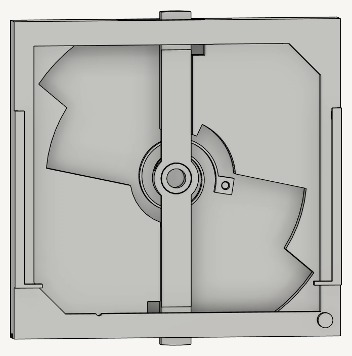

# Eventually, la caja: parche v4.1

Respuesta al contra-reporte de la v4 (`contra-reporte-v4.md`, commit `f3f798a`).

Escrito el 20 de noviembre de 2026. **No es una versión nueva:** es el mismo modelo v4 con los errores señalados corregidos en `generador_caja_v4.py`. Los ficheros de `imprimir-v4\` y `probetas-v4\` están **regenerados y sustituyen** a los anteriores, con los mismos nombres. **Sigue sin haber nada impreso ni medido.**

Procedencia de cada cifra: **del modelo** (Fusion), **calculada** por mí, o **del contra-reporte**.

## 1. Qué he cambiado

| | Qué decía el contra-reporte | Qué hay ahora | Cómo lo he comprobado |
| --- | --- | --- | --- |
| **G1** | La ranura de emergencia no llega al pestillo | La ranura es pasante hasta la cara de arriba del suelo | **Del modelo:** `main()` pasa ahora un clip de 1 mm por toda la ranura, de +5,0 a −21,6 mm, sin tocar la caja, y comprueba que alcanza el pestillo |
| **G2** | El taco del muelle se sale del diente | Fuera el diente. El taco tiene un **ojo** que entra en un **tetón** del panel: queda sujeto en todas direcciones. Un resalte de la tapa trasera impide que se levante | **Del modelo:** sin choques entre rotor, panel y tapa. No he recalculado la forma deformada de la espiral |
| **I1** | El retén de la peana es un aprieto entre piezas rígidas | Una **lengüeta** de 12 × 1,2 mm a cada lado de la base, con un resalte redondo que cae en una muesca de la guía | **Calculado:** 0,7 N por lengüeta al flexar 0,4 mm; unos 2,7 N para sacarla; trabaja al 0,5 % y descansa relajada |
| **I2** | El retén de la funda sale justo | Nervios de 0,8 mm con el mismo rebaje | **Estimado**, con la rigidez de pared del contra-reporte: de 2,5 a 10 N. Queda con 0,2 mm de aprieto ya asentada |
| **I3** | Abrir y cerrar con la aguja se contradicen | Un solo gesto: se abre girando a la derecha y tirando; **se cierra girando la aguja de vuelta** y quitándola. Imanes de esquina bajo 1,8 mm: 0,69 N entre los dos, para que valga tirar del centro de la aguja (0,96 N) | **Calculado.** El pomo sigue sin decidir |
| **I4** | Dos puentes con menos holgura de la que descuelgan | Puntas del rotor rebajadas 0,4 mm por detrás. Holgura hacia el labio de la caja de 0,15 a 0,35 mm | **Del modelo** |
| **I5** | La tapa trasera no se sujeta | Pestaña de 18 mm que entra bajo la banda de arriba y lengüeta-clip en el borde de abajo. Sin pegamento | **Calculado:** 0,9 N en el clip. **Del modelo:** sin choques |
| **I8** | Guías sin entrada | Chaflán de 1,5 mm en la boca de las dos guías | **Del modelo** |
| 6.2 | Plan de pruebas | Corregido: 20 giros en P1, mirar el taco antes de tocar el muelle, aviso sobre la funda corta | — |

## 2. Qué no he cambiado, y por qué

- **I6, el pico articulado.** Sigue igual: es opcional. Corrijo el dato: el límite que manda es un rozamiento de 0,35 (**del contra-reporte**), no el 0,76 que di yo.
- **I7, el aire y las medidas.** Nada hasta medir, como pide el contra-reporte.
- **I8, retén de la aguja con un imán.** No lo he puesto: gasta un imán de la reserva y es decisión tuya. Los dos puntos de roce siguen, y ya sé que con 0,03 mm no existen al imprimir.
- **I8, lo que se ve** (nervios, cunas, rebaje redondo): es juicio estético tuyo.

## 3. Efectos secundarios del parche

- **El panel tiene 0,65 mm de juego hacia fuera** antes de que el pestillo muerda (0,30 del rotor más 0,35 del labio). Antes eran 0,45. Los imanes lo mantienen a ras, pero ahora son más flojos.
- **La tapa trasera se imprime con la cara de atrás en la cama**, al revés que antes: su resalte queda hacia arriba. El fichero ya viene girado.
- **El modelo marca un choque de 24 mm³ entre caja y funda.** Es el aprieto de los nervios, a propósito.
- **Parámetros:** 178 (eran 165). Las medidas exteriores no cambian: 98,6 × 76,0 × 95,4 mm.

## 4. Lo que sigue incierto

1. **Que el taco se monte bien.** Hay que levantarlo 1 mm para pasarlo sobre el tetón.
2. **Las dos lengüetas nuevas y el clip.** Calculados, no impresos.
3. **El retén de la funda.** El intervalo estimado es ancho.
4. **Que 0,69 N basten** para que el panel no se salga solo al mover la caja sin funda.
5. Todo lo que dependía de la medida del reloj.

## 5. Qué tienes que hacer

1. **Imprimir P0**, y después **P1 y P2 con los ficheros nuevos** de `probetas-v4\`. Los de la v4 que subiste a GitHub son los anteriores y ya no valen.
2. **Medir el reloj**, tres cosas: contorno interior del brazalete, y alto y fondo del lazo cerrado y apoyado en la mesa.
3. **GitHub: hecho, no tienes que hacer nada.** Claude subió el parche el 20-nov-2026 y lo fusionó en `main` (pull request nº 1). Cambian: `generador_caja_v4.py`, `parametros-fusion-v4.csv`, `Eventually-caja-v4.f3d`, `Eventually-caja-v4.step`, todo `imprimir-v4\` y `probetas-v4\`, `reporte-v4\guia-de-montaje.md`, `reporte-v4\plan-de-pruebas.md`, `contexto.md`, `README.md` y `LEEME.txt`. Nuevos: `reporte-v4\parche-v4.1.md` y `.pdf`, `capturas\v4.1-panel-por-detras.png` y `contra-reporte-v4.md`.
4. **Contestar:** fecha de entrega; si te vale cerrar girando la aguja de vuelta; aguja con pomo o no; y si la otra sesión pone en la web la pista y el aviso.
