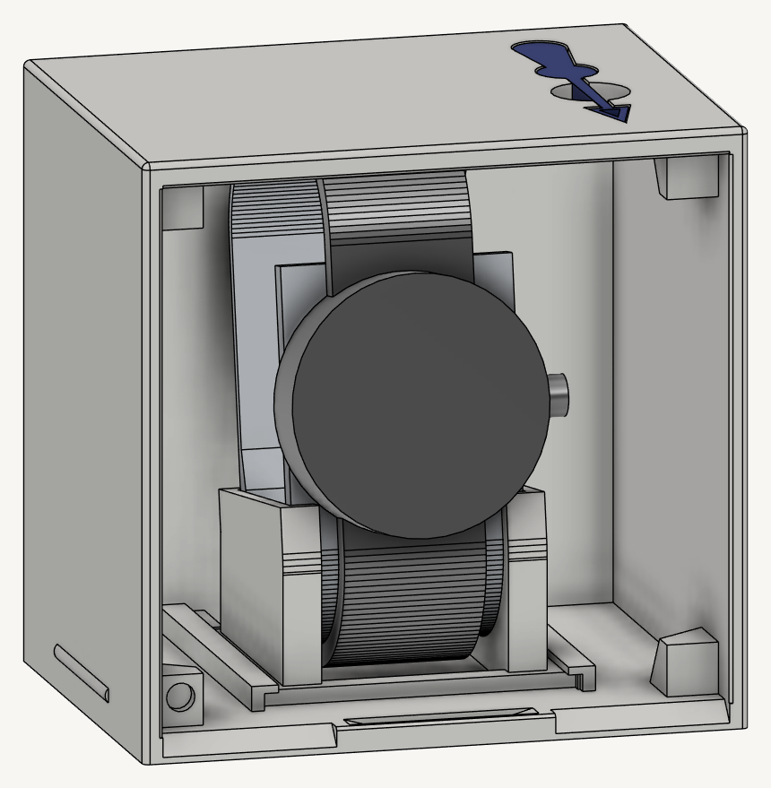
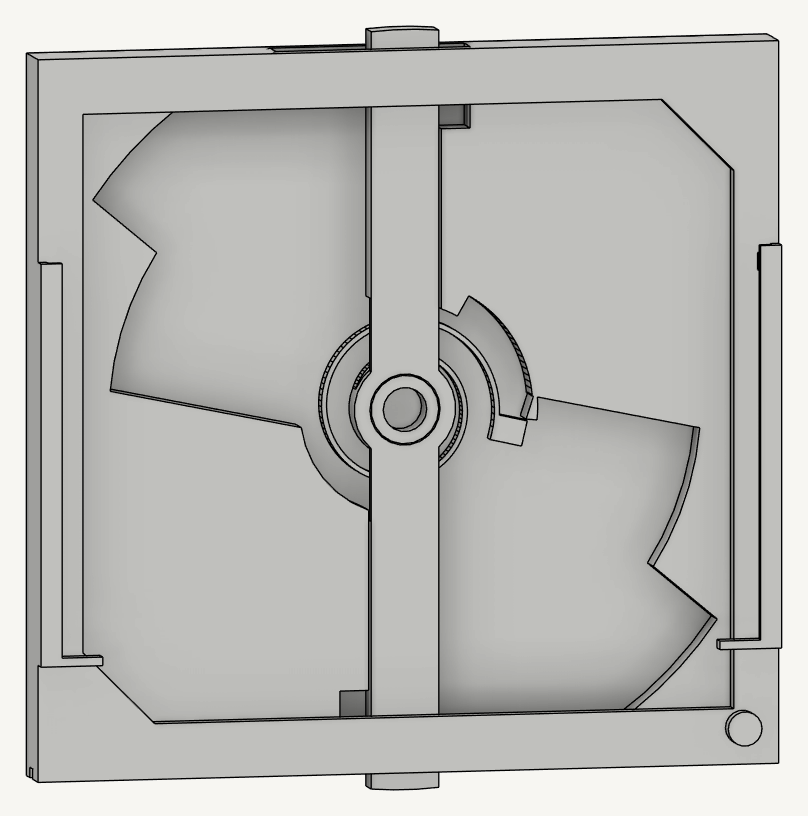

# Eventually, la caja: prototipo v4

Respuesta al contra-reporte de la v3 (`contra-reporte-v3.md`, commit `ddc97e8`).

Escrito el 20 de noviembre de 2026. La v4 está **modelada en Fusion y exportada**. **Sigue sin haber nada impreso ni medido.** Cada cifra dice de dónde sale: **del modelo** (Fusion), **calculada** o **del contra-reporte** (la doy por buena sin repetirla).

## 1. Resumen

- **Base de la v4: el nivel 2 del contra-reporte.** Rotor rígido de un solo sentido, con tope y muelle precargado. La caja **se cierra con la aguja puesta**: aguja girada, panel dentro, aguja fuera.
- **El cierre de un empujón pasa a ser opcional.** Hay un segundo rotor, con pico articulado, que cabe en el mismo panel y la misma caja. Solo entra si pasa la probeta P2. Es la pieza con más riesgo y **no está probada**.
- **Los 4 fallos graves tienen cambio en el modelo:** rotor con tope (G1), pinza a medida dibujada en su forma libre (G2), peana corredera que sale tirando del reloj (G3) y emergencia por la base, arrastrando de lado (G4).
- **Tamaño con funda: 98,6 × 76,0 × 95,4 mm.** Un milímetro más de fondo y de alto que la v3. El contra-reporte esperaba que bajara; no baja, y explico por qué en el apartado 4.
- **8 imanes**, como en la v3.
- **Lo que no he hecho:** la pista de apertura y el aviso del imán en la web (punto 12), y los tres puntos «a valorar contigo» (16, 17 y 18).
- **Sigue en pie lo más importante del contra-reporte: ninguna caja entera sin medir antes el reloj.** La v4 está calculada para un brazalete de 180 mm que nadie ha medido.

 

## 2. Cómo se usa ahora

1. Se levanta la funda. Dos nervios la retienen: hay que dar un tirón suave.
2. La aguja está encima de la caja, a ras. Se pone en el centro del frente, punta arriba.
3. Se gira a la derecha hasta el tope y se tira **de la aguja**: el panel sale con ella (1,2 N lo sujetan; la aguja agarra con 1,7).
4. Se tira del reloj hacia fuera: sale con su pinza y su peana, deslizando. Sirve así de expositor en la mesilla.
5. **Para cerrar:** peana dentro hasta el clic, aguja girada en el panel, panel dentro, aguja fuera. El muelle echa el pestillo.

## 3. Respuesta punto por punto

### Fallos graves

| | Qué decía | Qué hay en la v4 | Estado |
| --- | --- | --- | --- |
| **G1** | El empujón se acuña | Fuera el resbalón de la v3. Rotor de un solo sentido; se cierra con la aguja puesta. Empujón solo con el rotor articulado, si pasa P2 | Modelado. P1 y P2 |
| **G2** | La pinza se dibuja con una forma falsa | Pinza a medida: contorno del brazalete más 6 mm. Se dibuja y se comprueba en su forma libre. El nicho se calcula con esa forma | Modelado. Falta la medida |
| **G3** | El reloj no entra ni sale | Peana corredera entre dos guías con labio. Entra y sale deslizando con el reloj puesto. Fuera talón y dientes | Modelado. P3 |
| **G4** | El taladro no suelta | Fuera el taladro del techo. Ranura en la **base**, sobre el recorrido del pestillo de abajo: un clip lo arrastra de lado | Modelado. P2 |

### Fallos importantes

| | Qué hay en la v4 |
| --- | --- |
| **I1** Reposo | Tope en cerrado. Espiral precargada 18°: empuja contra el tope con unos 0,34 mN·m y pide 1,3 a 50°, de los 5,0 que da la aguja (**del contra-reporte**, con su rigidez de 19 µN·m por grado) |
| **I2** Tirón | Detrás de cada pestillo queda una banda maciza del propio panel, de 6,5 mm de alto y 1,9 de grueso. El rotor se mete girado 45°, donde no hay banda. Con 1 kg por pestillo, la banda trabaja a unos 12 MPa y cede 0,13 mm (**calculado**, viga apoyada de 19 mm) |
| **I3** Mecanismo a la vista | Tapa trasera entera: cubre toda la cámara. Sin ventanas |
| **I4** Funda | Dos nervios de 0,5 mm en los costados de la caja, a 6 mm de la base, y sus rebajes en la funda. **Sin calcular la fuerza:** lo dirá P4, lastrada |
| **I5** Uña | Imanes de esquina bajo 1,3 mm: 0,61 N cada uno, 1,2 N los dos. La aguja agarra con 1,67 N (**calculado**). Margen de 1,4, como avisaba el contra-reporte: hay que probarlo. El bisel y la ranura para la uña se quedan, por si no sale |
| **I6** Pista | **No hecho.** Va en la web; ver apartado 6 |
| **I7** Cara lisa | Fuera la esquina achaflanada: el frente vuelve a ser un rectángulo liso. El «solo entra al derecho» es ahora un resalte por detrás del panel y su agujero en un refuerzo de la caja. El taladro ya no está en el techo. La peana no tiene dientes. **El rebaje redondo de la aguja sigue** |
| **I8** Tamaño | Aire de arriba de 3 a 1,5 mm. Ver apartado 4 |
| **I9** Imanes embutidos | Orden de impresión en la guía: primero la base. Probeta nueva `p0-iman-embutido` para comparar con un imán suelto |
| **I10** Piezas sueltas | Dos puntos de roce en el rebaje de la aguja. Un resalte en cada carril que pellizca la tarjeta |

### «Qué cambiar», uno por uno

| # | Punto | Estado |
| --- | --- | --- |
| 1 | Rotor de un sentido, tope, precarga | Hecho (18°) |
| 2 | Cierre con la aguja; empujón solo si pasa P2 | Hecho |
| 3 | Puente macizo y tapa trasera entera | Hecho |
| 4 | Pinza a medida + 6 mm; forma libre | Hecho, **con la medida supuesta** |
| 5 | Peana corredera con labio y retén | Hecho |
| 6 | Emergencia por la base; dos imanes abren | Hecho; lo de los imanes, en la guía |
| 7 | Retén de la funda | Hecho, sin calcular |
| 8 | Corregir guía y plan de pruebas | Hecho |
| 9 | Ninguna caja entera sin medir el reloj | **Depende de ti.** Lo digo en la guía y en el plan |
| 10 | «Al derecho» por detrás | Hecho |
| 11 | Sujeción de 1,2 N | Hecho |
| 12 | Pista y aviso en la web | **No hecho** |
| 13 | Retén de aguja y de tarjeta | Hecho |
| 14 | Orden de impresión; prueba de calor | Hecho |
| 15 | Aire de arriba a 1,5 mm | Hecho |
| 16 | Quitar los imanes de esquina | No. Decides tú |
| 17 | Rotor articulado en PETG | No decidido. La probeta sirve para los dos materiales |
| 18 | Texto por dentro, pomo | No. Decides tú |

### El rotor articulado

Es el «pico articulado» del apartado 7 del contra-reporte, dibujado:

- La barra acaba antes. De su extremo sale un codo, una lámina de 0,6 × 6 mm y un bracito hasta el pico.
- La boca empuja el pico hacia abajo. El brazo de esa fuerza es de 11,2 mm y el del rozamiento de 14,7: bascula con rozamientos de hasta 0,76 (**calculado**, sin contar el roce del chaflán).
- Bascula 11,3°. La lámina trabaja al 0,98 %, solo durante el empujón. Pide unos 0,5 N por pico.
- **Del modelo:** en reposo no toca ni panel ni caja. Gira libre de 0° a 47°; el rígido llega a 50°. Por cálculo se libera hacia los 24°; el rígido, a 23°.
- **No comprobado:** que bascule de verdad. El modelo no dobla piezas.

## 4. Por qué no baja el tamaño

El contra-reporte calculaba que sobraban unos 5 mm de alto. La v4 mide 95,4 de alto; la v3, 94,4.

| Cambio | Efecto en el alto |
| --- | --- |
| Nicho calculado con la pinza libre (186 mm) en vez de la forma supuesta de la v3 | +3,0 mm |
| Aire de arriba de 3 a 1,5 mm | −1,5 mm |
| Hueco bajo la pinza de 5 a 4,5 mm | −0,5 mm |

Los 5 mm que sobraban eran con una pinza de 200 doblada hasta 180, que se aplasta. La pinza a medida no se aplasta: ocupa lo que mide. El fondo sube 1 mm porque el panel engorda de 6,0 a 6,6 para dar grueso a los puentes.

La base de la peana es un marco: el brazalete cuelga por el hueco. Si fuera maciza, la caja mediría 2,4 mm más.

## 5. Lo que sigue incierto

1. **La medida del brazalete.** Todo el interior depende de ella.
2. **El rotor articulado.** Dibujado y calculado; nada más.
3. **El retén de la funda.** Puede quedar duro o no retener.
4. **Que la aguja saque el panel.** Margen de 1,4.
5. **La tapa trasera va a presión**, sin cola de milano: es la forma que cubre toda la cámara. Puede quedar floja. La tarjeta la tapa.
6. **El montaje del taco de la espiral.** Hay que llevarlo con un clip hasta pasar un diente. Es nuevo.
7. Lo que ya estaba en la v3: que la espiral salga suelta, el labio de los carriles, los imanes embutidos.

## 6. Lo que tienes que hacer

1. **Medir el reloj.** Contorno interior del brazalete cerrado, con una tira de papel. Es el paso 1 del plan.
2. **Imprimir P0 y P1.** Las de la v4 están en `probetas-v4\`.
3. **Subir la v4 a GitHub.** Sigo sin poder: ficheros en el apartado 7.
4. **Contestar** lo que solo puedes contestar tú: qué día se entrega; si te vale cerrar con la aguja puesta; si quieres conservar el clic de imán del panel; y si la otra sesión pone en la web la pista («la aguja abre la caja: adelanta la hora») y el aviso del imán.

## 7. Ficheros nuevos

Todos en `C:\Users\pepea\Documents\FusionClaude\WatchBox`:

- `generador_caja_v4.py` (165 parámetros; usa `frase-v3.json`) y `parametros-fusion-v4.csv`
- `Eventually-caja-v4.f3d` y `Eventually-caja-v4.step`
- `imprimir-v4\` (9 piezas) y `probetas-v4\` (17 ficheros)
- `reporte-v4\` (este reporte, `guia-de-montaje.md`, `plan-de-pruebas.md`)
- `capturas\v4-*.png`
- `contra-reporte-v3.md` (copia del repositorio)
- Cambian `README.md`, `LEEME.txt` y `contexto.md`
